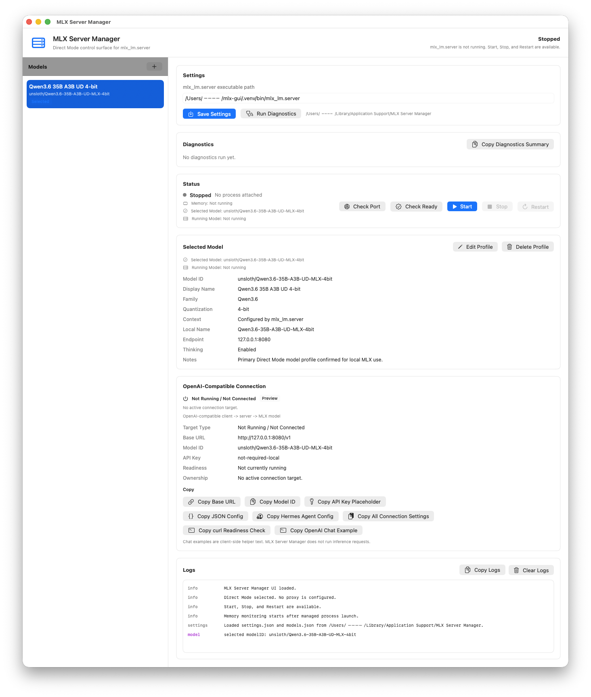
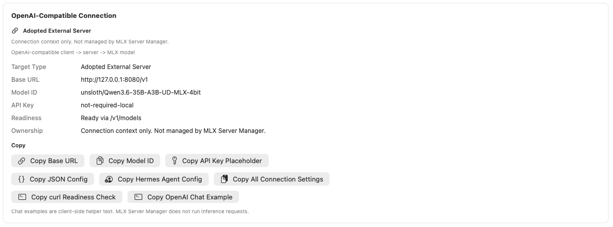
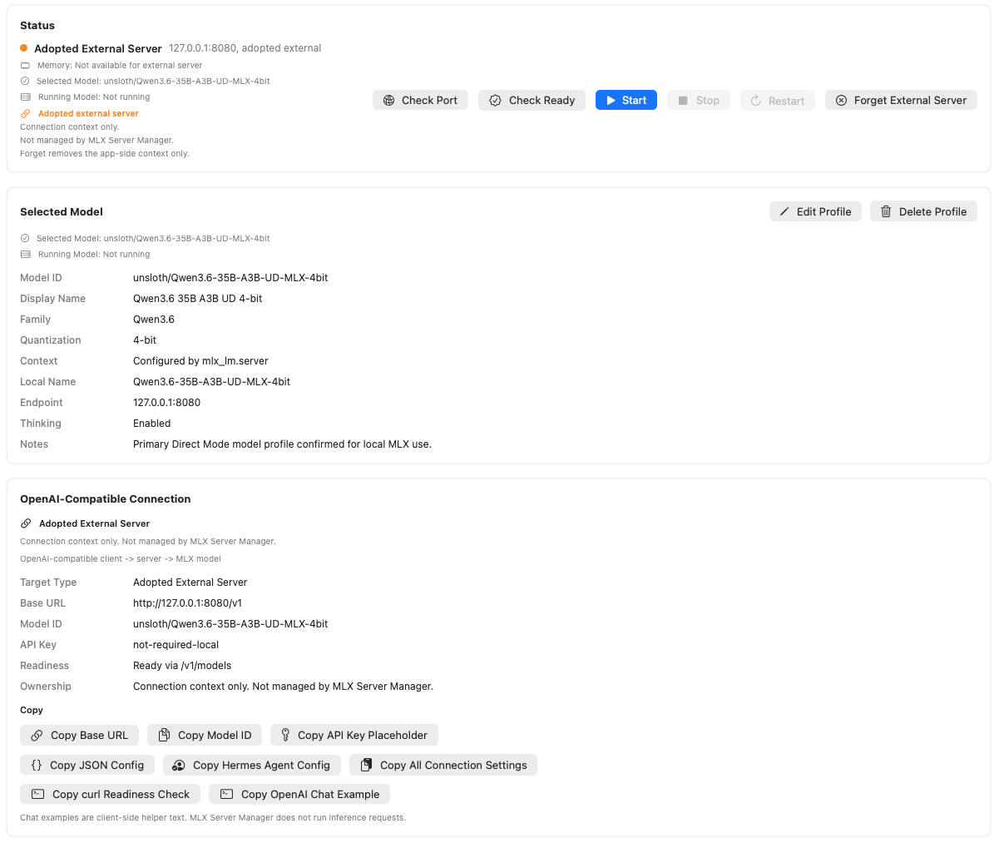
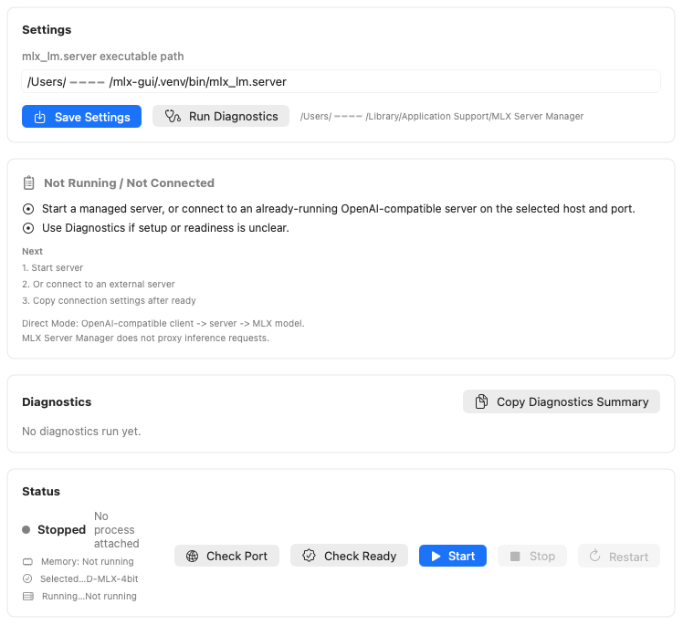

# MLX Server Manager

MLX Server Manager es una interfaz gráfica de usuario (GUI) ligera para macOS SwiftUI destinada a operar puntos finales MLX compatibles con OpenAI en local en Modo Directo.

Es una superficie de control para los procesos `mlx_lm.server` y Rapid-MLX gestionados por la aplicación, con soporte para detectar y adoptar un servidor externo compatible con OpenAI ya en ejecución como contexto de conexión.

La aplicación mantiene el Modo Directo:

```text
Cliente compatible con OpenAI -> backend gestionado seleccionado o servidor externo adoptado -> modelo MLX
```

MLX Server Manager controla y observa los procesos de servidor locales gestionados por la aplicación, pero no interviene en la ruta de las solicitudes de inferencia. Los clientes compatibles con OpenAI se conectan directamente al punto final del servidor.

## Capturas de pantalla

### Panel principal



El panel principal muestra el flujo de trabajo central de MLX Server Manager en un solo lugar: perfiles de modelo, configuración de la aplicación, diagnósticos, estado del servidor, detalles del modelo seleccionado, configuración de conexión compatible con OpenAI y registros.

MLX Server Manager sigue siendo una superficie de control en Modo Directo. No actúa como proxy para solicitudes de inferencia ni enruta solicitudes entre backends.

### Configuración de conexión / Objetivo actual



Configuración de conexión muestra claramente el objetivo actual compatible con OpenAI.

Muestra:

- tipo de objetivo
- URL base
- ID del modelo
- marcador de posición de la clave API
- punto final de disponibilidad
- nota de propiedad
- acciones de copia para la configuración del cliente

Las acciones de copia ayudan a configurar clientes compatibles con OpenAI, incluido Hermes Agent, sin enrutar la inferencia a través de MLX Server Manager.

### Servidor externo adoptado



El modo Servidor externo adoptado permite a los usuarios utilizar un servidor externo compatible con OpenAI detectado como contexto de conexión.

Adoptar no significa propiedad del proceso. MLX Server Manager no detiene, reinicia, elimina, monitorea la memoria ni recopila registros de servidores externos adoptados.

La ruta de Modo Directo se mantiene:

`Cliente compatible con OpenAI -> backend gestionado seleccionado o servidor externo adoptado -> modelo MLX`

### Guía de incorporación al primer inicio



El panel de guía de incorporación ofrece pistas de configuración breves y con conciencia del estado para usuarios por primera vez.

Ayuda a los usuarios a comprender qué configurar a continuación, como la ruta del ejecutable `mlx_lm.server`, el perfil de modelo seleccionado, el estado del servidor y la configuración de conexión.

La guía es solo informativa. No instala dependencias, descarga modelos, inicia procesos externos, actúa como proxy de inferencia ni cambia la propiedad del proceso.

## Por qué existe este proyecto

Los servidores MLX locales son rápidos y simples, pero el uso diario se beneficia de una pequeña interfaz gráfica para la gestión de procesos, diagnósticos, perfiles de modelo, registros, visualización de memoria, visibilidad de puntos finales externos y configuración de conexión.

MLX Server Manager existe para proporcionar esa capa de gestión sin convertirse en la capa de inferencia. El objetivo es facilitar la operación de servidores MLX locales compatibles para clientes compatibles con OpenAI, especialmente herramientas de agentes que necesitan puntos finales locales estables.

## Principios del proyecto

MLX Server Manager sigue tres principios de producto:

1. Preservar el rendimiento de inferencia local directa como prioridad máxima.
2. Hacer que los servidores MLX compatibles sean utilizables para usuarios que no se sientan cómodos con flujos de trabajo de CLI.
3. Adoptar características útiles de herramientas de LLM locales cuando no entren en conflicto con el rendimiento, la seguridad o los límites del Modo Directo.

Consulte [docs/product_direction.md](docs/product_direction.md) para ver la dirección completa del proyecto, incluidos los objetivos no deseados actuales y las características candidatas futuras.

## Qué es esto

- Una aplicación local para macOS para iniciar, detener y reiniciar de forma independiente los procesos `mlx_lm.server` y Rapid-MLX gestionados por la aplicación.
- Una superficie de estado y diagnósticos para verificaciones de disponibilidad mediante `GET /v1/models`.
- Un editor de perfiles de modelo para configuraciones de punto final local compatible con OpenAI.
- Una visualización de registros y memoria de procesos gestionados.
- Un copiador de configuración de conexión en Modo Directo para clientes compatibles con OpenAI.
- Un detector conservador de servidores externos para puntos finales de host/puerto seleccionados.
- Un flujo de Adopción de servidor externo solo para contexto de conexión, no para propiedad del proceso.

## Qué no es esto

- No es una interfaz de chat de propósito general. El Chat de prueba es un diagnóstico de punto final de un solo mensaje para confirmar que el modelo seleccionado responde.
- No es un proxy de inferencia.
- No incluye navegación completa de tarjetas de modelos de Hugging Face, almacenamiento de tokens HF, eliminación de carpetas de modelos locales ni limpieza amplia de cachés.
- No es una herramienta general de eliminación de archivos de modelo. Solo se puede eliminar una caché coincidente del hub de Hugging Face como una acción separada de eliminación de perfil explícitamente confirmada.
- No es un enrutador de inferencia entre backends.
- No es un reemplazo para los tiempos de ejecución del servidor compatibles ni para la configuración de modelos.

## Instalación

Descargue el activo de lanzamiento del código de la aplicación más reciente desde GitHub Releases:

```text
MLXServerManager-v40.0.0-unsigned.zip
```

En la página de lanzamiento de GitHub, utilice el archivo listado bajo **Activos** con este nombre exacto. No utilice **Código fuente (zip)** ni **Código fuente (tar.gz)** cuando desee la aplicación.

`v40.0.0` es el lanzamiento del código de la aplicación publicado más recientemente.

Verifique la suma de comprobación antes de abrir la aplicación:

```text
SHA-256: ce141f0da069fc6182efae52a08739118d98744c4d0e877ddc06c4b09eaee6e6
```

Desde la carpeta que contiene el zip descargado, puede verificarlo con:

```sh
shasum -a 256 MLXServerManager-v40.0.0-unsigned.zip
```

Extraiga el zip y confirme que contiene `MLXServerManager.app`. Mueva la aplicación a su ubicación local preferida, como `/Applications` o una carpeta de aplicaciones de usuario.

Esta es una compilación local sin firma ni notificación para uso local. macOS puede mostrar una advertencia de Gatekeeper. Si confía en el activo del lanzamiento, verifique el contenido del zip y la suma de comprobación antes de eliminar la cuarentena:

```sh
xattr -dr com.apple.quarantine /ruta/a/MLXServerManager.app
open -n /ruta/a/MLXServerManager.app
```

No descargue el archivo de código fuente si desea el binario de la aplicación. Utilice el activo de lanzamiento llamado `MLXServerManager-v40.0.0-unsigned.zip`.

## Inicio rápido

1. Abra `MLXServerManager.app`.
2. Revise la lista de verificación de inicio de Dashboard y corrija los elementos faltantes desde las acciones siguientes mostradas.
3. Utilice el selector de ejecutables o Configuración para establecer la `ruta del ejecutable mlx_lm.server`.
4. Agregue un modelo utilizando una de las rutas de Dashboard:
   - busque en Hugging Face, elija un resultado, revise la vista previa y descárguelo;
   - pegue un ID de modelo / URL de Hugging Face y descárguelo;
   - registre una carpeta de modelo local existente con el selector de carpetas;
   - o utilice el editor de perfiles avanzado.
5. Confirme que el modelo aparece en la lista de modelos, tiene la insignia de origen esperada y está seleccionado. Utilice el filtro de origen cuando tenga muchos perfiles.
6. Utilice los diagnósticos de tiempo de ejecución y la comprobación previa a inicio antes de lanzar `mlx_lm.server`.
7. Después de que el servidor esté listo, ejecute la prueba de velocidad explícita para medir la latencia de `/v1/models`.
8. Revise el historial de benchmarks, latencia media/máxima, y guía de fallas en el panel de tiempo de ejecución de Dashboard.
9. Si una descarga falla, utilice las acciones de restaurar cola, copiar URL o Reintentar.
10. Confirme el resumen del Objetivo actual en Configuración de conexión o la tarjeta de conexión de Dashboard.
11. Copie la configuración para Hermes Agent, OpenAI-compatible genérico, preset de curl o resumen de benchmark.
12. Pegue los valores de conexión en un cliente compatible con OpenAI.

## Dirección actual de la GUI

v40.0.0 es el lanzamiento de la aplicación publicado actualmente. El árbol de desarrollo apunta a v50.0.0 y añade una línea base de plataforma macOS 15.0 / Apple Silicon, seguimiento de frescura de evidencia, Doctor de Entorno de Tiempo de Ejecución, inspección de metadatos de modelos registrados, comprobaciones explícitas de estabilidad post-inicio, instantáneas de calibración de recursos locales, Planes de Inicio persistentes, planificación multi-modelo con capacidad consciente, un Paquete de Soporte anonimizado y un Centro de Operaciones unificado. La lista de modelos sigue siendo la tabla de operaciones principal y el Modo Directo permanece sin cambios.

Debe proporcionar su propio entorno y ejecutable de backend compatible. Puede registrar archivos de modelo existentes, buscar en Hugging Face y elegir un resultado, o utilizar Descargas para obtener un modelo por ID / URL y agregarlo automáticamente a la lista de modelos. La aplicación mantiene el Modo Directo: los clientes se conectan directamente al punto final seleccionado y MLX Server Manager nunca actúa como proxy del tráfico del cliente. Las solicitudes de generación de Chat de prueba, Benchmark y Preparación para Agentes ocurren solo cuando el usuario ejecuta explícitamente esos diagnósticos.

Consulte [docs/v35_v40_implementation.md](docs/v35_v40_implementation.md) para los límites de implementación de v35–v40, [docs/v41_v50_implementation.md](docs/v41_v50_implementation.md) para el alcance de desarrollo de v41–v50, y [docs/v40_release_candidate_readiness.md](docs/v40_release_candidate_readiness.md) para el registro de verificación publicado más reciente.

Consulte [docs/distribution.md](docs/distribution.md) para detalles de activos de lanzamiento y Gatekeeper, [docs/known_limitations.md](docs/known_limitations.md) para el límite completo del alcance estable, y [docs/v23_0_integrated_gui_refresh.md](docs/v23_0_integrated_gui_refresh.md) para la nota de actualización de GUI de v23.0.0.

Consulte [docs/benchmark_findings.md](docs/benchmark_findings.md) para notas basadas en benchmarks sobre Modo Directo, cargas de trabajo de contexto largo, streaming TTFT y futuras Opciones de Inicio Avanzadas opcionales.

Las Opciones de Inicio Avanzadas son configuraciones ajustables por usuario por perfil y opcionales. Están vacías por defecto y se omiten en los argumentos de inicio a menos que se configuren explícitamente. Consulte [docs/advanced_launch_options.md](docs/advanced_launch_options.md) para notas de diseño y límites de seguridad.

La detección de servidores externos está documentada en [docs/external_server_detection.md](docs/external_server_detection.md). Detecta servidores compatibles con OpenAI existentes en el host/puerto seleccionado sin tomar posesión de procesos externos.

El comportamiento de Adopción de servidor externo está documentado en [docs/adopt_external_server.md](docs/adopt_external_server.md). v1.7.0 añade la implementación inicial para adoptar explícitamente un servidor externo detectado solo como contexto de conexión, sin tomar posesión del proceso.

El pulido de Configuración de conexión está documentado en [docs/connection_settings_polish.md](docs/connection_settings_polish.md). v1.9.0 implementa el resumen inicial del Objetivo actual y acciones de copia expandidas para estados de conexión Gestionado, Externo Detectado, Adoptado y No en ejecución. El Modo Directo permanece sin cambios.

La actualización de interfaz de usuario Dashboard v1 está documentada en [docs/dashboard_ui_refresh.md](docs/dashboard_ui_refresh.md). v4.2.0 a v4.9.0 construyeron el dashboard en pasos pequeños orientados a la visualización. v5.0.0 finaliza Dashboard v1 como la vista general estable actual para Próximos Pasos, Objetivo Actual, Estado del Servidor, Configuración del Cliente, Diagnósticos & Registros y Perfiles / Importar Exportar mientras preserva el comportamiento del ciclo de vida, Modo Directo, límites de propiedad de servidor externo y comportamiento de Importar / Exportar. v5.1.0 mantiene esa superficie estable y documenta ideas de diseño más grandes como trabajo futuro en lugar de parte de Dashboard v1.

La planificación de Actualización de Diseño Completo de la Aplicación está documentada en [docs/full_app_layout_refresh.md](docs/full_app_layout_refresh.md). v5.2.0 es un lanzamiento solo de documentos de planificación para posibles superficies futuras de v6.x de barra lateral, perfiles, servidor, registros, configuración del cliente e inspector. No implementa un nuevo diseño ni cambia el comportamiento de Dashboard v1.

La Fundación de Capa / Barra Lateral de la Aplicación está documentada en [docs/app_shell_sidebar_foundation.md](docs/app_shell_sidebar_foundation.md). v5.3.0 introdujo el diseño solo de documentos, y v6.0.0 implementa la capa de barra lateral nativa inicial con Dashboard como la única sección superior activa por defecto. No cambia el comportamiento de tiempo de ejecución, Modo Directo, controles de ciclo de vida, comportamiento de Importar / Exportar, comportamiento de red o persistencia.

El diseño de la Superficie de Perfiles / Lista de Modelos está documentado en [docs/profiles_model_list_surface.md](docs/profiles_model_list_surface.md). v5.4.0 es un lanzamiento de diseño detallado solo de documentos para una posible sección de Perfiles de v6.1.0 futura; no implementa una tabla de lista de modelos, descarga de modelo, eliminación de modelo ni cambios de comportamiento de perfil.

El diseño de la Fundación de Inspector de Detalles está documentada en [docs/detail_inspector_foundation.md](docs/detail_inspector_foundation.md). v5.5.0 es un lanzamiento de diseño detallado solo de documentos para un posible área de inspector de v6.2.0 futura; no implementa interfaz de usuario de inspector, pruebas de punto final, gestión de archivos de modelo ni cambios de comportamiento.

El diseño de Actualización del Panel de Registros está documentado en [docs/logs_panel_refresh.md](docs/logs_panel_refresh.md). v6.3.0 implementa la primera Actualización del Panel de Registros como un destino de barra lateral superior para el ciclo de vida gestionado por la aplicación y el contexto de registros. v6.3.1 pule la vista de registros compartida con visualización de cantidad de entradas e identificadores estables. No implementa captura de registros externos, telemetría, monitoreo en segundo plano ni cambios de comportamiento.

El diseño de la Superficie de Configuración del Cliente está documentado en [docs/client_setup_surface.md](docs/client_setup_surface.md). v6.4.0 implementa la primera superficie de Configuración del Cliente como un destino de barra lateral superior para valores de configuración compatibles con OpenAI seguros para copiar. v6.4.1 pule esa superficie con una tarjeta de alcance de copia. No implementa configuraciones de cliente generadas, almacenamiento de claves API, pruebas de punto final, proxy ni cambios de comportamiento.

El diseño de Métricas / Contexto del Sistema está documentado en [docs/metrics_system_context.md](docs/metrics_system_context.md). v6.5.0 implementa la primera superficie de Métricas / Contexto del Sistema como un destino de barra lateral superior de solo lectura. v6.5.1 pule esa superficie con una tarjeta de alcance de contexto. No implementa monitoreo activo del sistema, telemetría, inspección de solicitudes ni cambios de comportamiento.

La Revisión de Listo para Implementación v6 está documentada en [docs/v6_implementation_readiness.md](docs/v6_implementation_readiness.md). v5.9.0 es un lanzamiento de preparación solo de documentos que consolida la planificación de v5.2.0 a v5.8.0; v6.0.0 comienza el trabajo de código de la aplicación solo con la estrecha Fundación de Capa / Barra Lateral de la Aplicación.

La Revisión de Estabilización del Diseño de Aplicación v6 está documentada en [docs/v6_app_layout_stabilization_review.md](docs/v6_app_layout_stabilization_review.md). v6.6.0 es una revisión de estabilización solo de documentos después del trabajo de Capa de Aplicación y superficie superior de v6.0.0 a v6.5.1. v6.6.1 pule esa revisión con criterios de entrada de la siguiente fase y una lista de verificación de verificación manual. Ambas no producen un nuevo binario de aplicación y mantienen el binario descargable actual en v6.5.1.

La Revisión de Listo para Distribución / Empaquetado está documentada en [docs/distribution_packaging_readiness.md](docs/distribution_packaging_readiness.md). v6.7.0 es un lanzamiento de preparación solo de documentos para decisiones futuras de firma, notificación, DMG y flujo de lanzamiento automatizado. v6.7.1 pule esa revisión con planificación de documentación de instalación y notas de verificación de empaquetado manual. v6.8.0 actualiza las secciones de Instalación e Inicio rápido del README alrededor del activo de aplicación sin firma actual. v6.8.1 pule la sección de instalación con una guía más clara de Activos de GitHub y un comando de suma de comprobación. v6.16.0 añade pulido de lista de verificación de empaquetado post-cierre para el caso en que la firma de Developer ID aún no esté lista. v6.16.1 añade guía de go/no-go para lanzamiento de binarios, casos de falla de nomenclatura de activos y notas de verificación del cuerpo del lanzamiento. v6.27.0 añade redacción de entrega de descarga actual para que los lanzamientos solo de documentos no apunten a los usuarios hacia los archivos de código fuente de GitHub como descarga de la aplicación. Estos lanzamientos no producen un nuevo binario de aplicación y mantienen el binario descargable actual en v6.5.1.

El Diseño de Distribución Firmada está documentado en [docs/signed_distribution_design.md](docs/signed_distribution_design.md). v6.9.0 es un lanzamiento de diseño solo de documentos para una futura ruta de distribución zip firmada. v6.9.1 pule ese diseño con criterios de entrada de implementación de firma, notas de verificación manual y criterios de decisión de coexistencia de activos. No firma la aplicación, ejecuta notificación, crea un DMG, crea un instalador, añade automatización de lanzamiento ni produce un nuevo binario de aplicación.

El Diseño del Flujo de Trabajo de Notificación está documentado en [docs/notarization_workflow_design.md](docs/notarization_workflow_design.md). v6.10.0 es un lanzamiento de diseño solo de documentos para una futura distribución notificada. v6.10.1 pule ese diseño con criterios de entrada de implementación, reglas conservadoras de redacción de estado y criterios de decisión de respaldo. Define límites de credenciales, flujo conceptual de notificación, manejo de resultados, nomenclatura de activos, requisitos de notas de lanzamiento, notas de verificación y política de respaldo sin ejecutar firma, notificación, sujeción, DMG, instalador, automatización de lanzamiento ni producir un nuevo binario de aplicación.

La Listo para Implementación de Zip Firmado está documentada en [docs/signed_zip_implementation_readiness.md](docs/signed_zip_implementation_readiness.md). v6.11.0 es una revisión de preparación solo de documentos para una futura implementación de zip firmada. v6.11.1 pule esa revisión de preparación con criterios Go / No-Go, una matriz de artefactos de lanzamiento y una plantilla de registro de verificación manual. Define puertas de preparación, precondiciones de firma local, flujo manual candidato, comprobaciones requeridas, entradas prohibidas, requisitos de notas de lanzamiento, requisitos de instalación del README y política de respaldo sin firmar la aplicación, producir un nuevo binario de aplicación ni cambiar el comportamiento de tiempo de ejecución.

El Borrador de Comando de Firma Local está documentado en [docs/local_signing_command_draft.md](docs/local_signing_command_draft.md). v6.12.0 es un borrador de comando solo de documentos para una futura creación de zip firmado local. v6.12.1 pule ese borrador con notas de pre-vuelo, expectativas de prueba en seco y advertencias de comando de firma más seguro. Documenta marcadores de posición, flujo de borrador de compilación/firma/verificación/zip/checksum, límites de seguridad, plantilla de registro de verificación y reglas de respaldo sin ejecutar firma ni cambiar el artefacto de lanzamiento actual.

La Lista de Verificación de Prueba en Seco de Zip Firmado está documentada en [docs/signed_zip_dry_run_checklist.md](docs/signed_zip_dry_run_checklist.md). v6.13.0 es un lanzamiento de lista de verificación solo de documentos para un futuro trabajo de prueba en seco de zip firmado. v6.13.1 pule esa lista de verificación con criterios de paso/fallo, expectativas de evidencia y condiciones de parada. Define el alcance de prueba en seco, comprobaciones de estado del repositorio, comprobaciones de alcance de lanzamiento, planificación de ruta de compilación, planificación de marcador de posición de firma, nomenclatura de zip, entradas prohibidas, estructura de notas de lanzamiento, decisiones de respaldo y una plantilla de registro de prueba en seco local sin subir un activo binario ni cambiar el comportamiento de tiempo de ejecución.

Las Notas de Ejecución de Prueba en Seco Local de Zip Firmado están documentadas en [docs/signed_zip_local_dry_run_execution_notes.md](docs/signed_zip_local_dry_run_execution_notes.md). v6.14.0 es un lanzamiento de notas de ejecución solo de documentos para futuras pruebas en seco de zip firmado solo locales. v6.14.1 pule esas notas con guía de lista de verificación de limpieza, redacción conservadora de resumen público y criterios de entrega antes de la implementación real de zip firmado. Define límites de ejecución, registros de prueba en seco local sugeridos, comprobaciones de alcance, comprobaciones de activo público, redacción de estado de marcador de posición, condiciones de parada, manejo de evidencia, criterios de documentación pública y política de respaldo sin firma, notificación, subida de binarios ni cambios de comportamiento de tiempo de ejecución.

El Cierre de Listo para Implementación de Zip Firmado está documentado en [docs/signed_zip_implementation_readiness_closeout.md](docs/signed_zip_implementation_readiness_closeout.md). v6.15.0 es un lanzamiento de cierre solo de documentos para la fase de preparación de zip firmado. Mapea los documentos de preparación, define criterios de entrada de implementación y no-go, registra redacción pública conservadora y política de nomenclatura de activos, y establece la siguiente bifurcación entre distribución real de zip firmado y pulido de empaquetado sin firma.

El Diseño de Descarga de Modelos está documentado en [docs/model_download_design.md](docs/model_download_design.md). v6.17.0 es un lanzamiento de diseño solo de documentos para posible soporte futuro de descarga de modelos. v6.17.1 pule ese diseño con estados de falla, pre-vuelo de espacio en disco, enmascaramiento de tokens y política de descarga parcial. Define límites de descarga, política de ruta de destino, límites de manejo de credenciales, límites de tarea de descarga, redacción de compatibilidad, límites de integración de perfil, lista de verificación de seguridad y expectativas de verificación sin descargar modelos, eliminar modelos, escanear directorios de modelos, limpiar cachés, persistir tokens ni cambiar el comportamiento de tiempo de ejecución.

La Documentación de Disponibilidad de Modelos está documentada en [docs/model_availability_documentation.md](docs/model_availability_documentation.md). v6.18.0 es un lanzamiento de documentación solo de documentos para futuras superficies de disponibilidad de modelos. v6.18.1 pule esa documentación con redacción de estado antiguo, alcance de comprobación explícito, advertencias de identificadores externos y reglas de copia de IU. Define términos de disponibilidad, disponibilidad de perfil local, disponibilidad de servidor externo, límite de compatibilidad, política de comprobación de rutas, redacción de privacidad y seguridad, y expectativas de verificación sin comprobar rutas automáticamente, escanear carpetas, descargar modelos, eliminar modelos ni cambiar el comportamiento de tiempo de ejecución.

El Diseño de la Superficie de Disponibilidad de Modelos está documentado en [docs/model_availability_surface_design.md](docs/model_availability_surface_design.md). v6.25.0 es un lanzamiento de diseño solo de documentos para una futura superficie de disponibilidad de modelos. Define opciones de ubicación conservadoras, preguntas del usuario, visualización de estado, comportamiento de comprobación explícito, visualización de ruta segura para copiar, límites de perfil y diagnósticos, límites de servidor externo, identificadores de accesibilidad, estados vacíos/de error, verificación manual y criterios de entrada de implementación sin añadir código Swift, pruebas, comprobaciones de rutas, escaneos de directorios, descargas, eliminación de modelos, ejecución de diagnósticos, llamadas a puntos finales, solicitudes de inferencia, monitoreo en segundo plano, telemetría ni cambios de comportamiento de tiempo de ejecución.

El Diseño de Diagnósticos Profundos está documentado en [docs/deeper_diagnostics_design.md](docs/deeper_diagnostics_design.md). v6.19.0 es un lanzamiento de diseño solo de documentos para futuras superficies de diagnósticos profundos. v6.19.1 pule ese diseño con reglas de guarda de activación de ejecución, política de gravedad, notas de tiempo de espera/cancelación y lista de verificación de enmascaramiento de exportación. Define categorías de diagnóstico, términos de resultado, alcance de comprobación explícito, política de punto final, política de ruta local, política de servidor externo, reglas de privacidad y enmascaramiento, límites de resumen de copia, límites de acción de reparación y expectativas de verificación sin ejecutar diagnósticos, añadir pruebas de punto final, enviar solicitudes de inferencia, monitoreo en segundo plano, inspección de tráfico, telemetría ni cambios de comportamiento de tiempo de ejecución.

El Diseño del Modelo de Resultado de Diagnóstico está documentado en [docs/diagnostics_result_model_design.md](docs/diagnostics_result_model_design.md). v6.20.0 es un lanzamiento de diseño solo de documentos para un futuro modelo de resultado de diagnóstico. v6.20.1 pule ese diseño con ID estables, elegibilidad de copia/exportación, precedencia de agregación y expectativas de fijo. Define forma de resultado candidata, valores de estado y gravedad, política de alcance y categoría, modelo de enmascaramiento, campos de mensaje, política de marca de tiempo, resultados de cancelación y tiempo de espera, reglas de agregación, formato de resumen de copia y límites de superficie de IU sin ejecutar diagnósticos, añadir pruebas de punto final, persistir historial de diagnósticos ni cambiar el comportamiento de tiempo de ejecución.

El Diseño del Fijo de Resultado de Diagnóstico está documentado en [docs/diagnostics_result_fixture_design.md](docs/diagnostics_result_fixture_design.md). v6.21.0 es un lanzamiento de diseño solo de documentos para futuros fijos de resultado de diagnóstico. v6.21.1 pule ese diseño con matriz de fijo, fijos negativos, reglas de orden determinista y seguridad de instantánea. Define política de nomenclatura de fijo, estado requerido, gravedad, alcance, categoría, enmascaramiento, resumen de copia, tiempo de espera/cancelación, propiedad de servidor externo, mutación de perfil seleccionado, agregación y expectativas de seguridad de datos de fijo sin añadir pruebas, ejecutar diagnósticos ni cambiar el comportamiento de tiempo de ejecución.

El Diseño de Distribución de Archivos de Fijo de Resultado de Diagnóstico está documentado en [docs/diagnostics_result_fixture_file_layout_design.md](docs/diagnostics_result_fixture_file_layout_design.md). v6.22.0 es un lanzamiento de diseño solo de documentos para futura distribución de archivos de fijo de diagnóstico. v6.22.1 pule ese diseño con límite de validación de esquema, reglas de inclusión de archivos, lista de verificación de revisión de fijo y criterios de entrada de implementación. v6.23.0 añade archivos de datos de fijo de diagnóstico iniciales bajo `MLXServerManagerTests/Fixtures/Diagnostics/` sin añadir código Swift, pruebas, ejecución de diagnósticos ni cambios de comportamiento de tiempo de ejecución. v6.23.1 pule esos archivos de fijo con un README de índice de fijo, fijo de gravedad bloqueante, fijo de compactación de ruta de inicio, fijo negativo de salida de comando sin procesar y actualización de cobertura de resumen copiado. v6.24.0 añade pruebas de carga de fijo de diagnóstico para resultados, enmascaramiento, negativos, agregación y fijos de resumen copiado sin añadir ejecución de diagnósticos de producción ni cambios de comportamiento de tiempo de ejecución. Compara JSON, fijos estáticos de Swift y ejemplos de Markdown, define directorios de fijo de prueba candidatos, reglas de nomenclatura, expectativas de esquema, seguridad de instantánea, distribución de fijo negativo, distribución de fijo de enmascaramiento, límites de destino de prueba y lista de verificación de revisión.

v6.0.1 es un pequeño lanzamiento de pulido de Capa de Aplicación / Barra Lateral. Mantiene Dashboard como la única sección superior activa y añade estilo de lista de barra lateral de macOS más pulido de accesibilidad de barra lateral. v6.0.2 continúa con higiene de lanzamiento de Capa de Aplicación antes de que comience el trabajo de v6.1.0. v6.0.3 añade identificadores de accesibilidad estables de Capa de Aplicación para la barra lateral, área de detalle y filas de sección sin cambiar el comportamiento de tiempo de ejecución. v6.0.4 añade pruebas de metadatos AppSection enfocadas para bloquear el límite de capa solo de Dashboard v6.0.x antes de que comience el trabajo de v6.1.0. v6.0.5 cierra la serie de fundación de Capa de Aplicación v6.0.x con una entrega de implementación v6.1 solo de documentos. v6.1.0 añade la primera Superficie de Perfiles / Lista de Modelos escalonada como un destino de barra lateral superior mientras mantiene Dashboard como la superficie de control de Modo Directo principal. v6.1.1 pule la superficie de Perfiles con tarjetas de resumen e identificadores de lista más claros mientras preserva el comportamiento de tiempo de ejecución. v6.2.0 añade la primera Fundación de Inspector de Detalles de solo lectura como un destino de barra lateral superior para detalles del perfil seleccionado y objetivo de conexión. v6.2.1 pule el Inspector con tarjetas de resumen e identificadores de estado de objetivo más claros mientras preserva el comportamiento de tiempo de ejecución. v6.3.0 añade la primera Actualización del Panel de Registros como un destino de barra lateral superior para el ciclo de vida gestionado por la aplicación y el contexto de registros mientras preserva el comportamiento de tiempo de ejecución. v6.3.1 pule LogView compartido con visualización de cantidad de entradas e identificadores estables mientras preserva el comportamiento de tiempo de ejecución. v6.4.0 añade la primera superficie de Configuración del Cliente como un destino de barra lateral superior para valores de configuración compatibles con OpenAI seguros para copiar mientras preserva el Modo Directo y el comportamiento de tiempo de ejecución. v6.4.1 pule Configuración del Cliente con una tarjeta de alcance de copia mientras preserva las acciones de copia existentes y el comportamiento de tiempo de ejecución. v6.5.0 añade la primera superficie de Métricas / Contexto del Sistema de solo lectura mientras preserva el Modo Directo y el comportamiento de tiempo de ejecución. v6.5.1 pule Métricas con una tarjeta de alcance de contexto mientras preserva el comportamiento de solo lectura. v6.6.0 registra una Revisión de Estabilización del Diseño de Aplicación solo de documentos y no produce un nuevo binario de aplicación. v6.6.1 pule la revisión de estabilización con criterios de entrada de la siguiente fase y notas de verificación manual. v6.7.0 añade una Revisión de Listo para Distribución / Empaquetado solo de documentos y no produce un nuevo binario de aplicación. v6.7.1 pule esa revisión con planificación de documentación de instalación y notas de verificación de empaquetado. v6.8.0 actualiza las secciones de Instalación e Inicio rápido del README mientras preserva el binario de aplicación actual v6.5.1. v6.8.1 pule la guía de instalación con detalles de Activos de GitHub y comando de suma de comprobación. v6.9.0 añade un Diseño de Distribución Firmada solo de documentos mientras preserva el binario de aplicación sin firma actual v6.5.1. v6.9.1 pule el diseño de distribución firmada con criterios de entrada y notas de verificación. v6.10.0 añade un Diseño del Flujo de Trabajo de Notificación solo de documentos mientras preserva el binario de aplicación sin firma actual v6.5.1. v6.10.1 pule el diseño del flujo de trabajo de notificación con criterios de entrada, redacción de estado y notas de decisión de respaldo. v6.11.0 añade una revisión de Listo para Implementación de Zip Firmado solo de documentos mientras preserva el binario de aplicación sin firma actual v6.5.1. v6.11.1 pule esa revisión de preparación con criterios Go / No-Go, estados de artefacto y guía de registro de verificación. v6.12.0 añade un Borrador de Comando de Firma Local solo de documentos. v6.12.1 pule ese borrador con notas de pre-vuelo, prueba en seco y advertencias de firma. v6.13.0 añade una Lista de Verificación de Prueba en Seco de Zip Firmado solo de documentos. v6.13.1 pule esa lista de verificación con criterios de paso/fallo, expectativas de evidencia y condiciones de parada. v6.14.0 añade Notas de Ejecución de Prueba en Seco Local de Zip Firmado solo de documentos. v6.14.1 pule esas notas con lista de verificación de limpieza, redacción de resumen público y criterios de entrega. v6.15.0 cierra la fase de preparación de zip firmado y define el siguiente punto de decisión de implementación. v6.16.0 añade pulido de lista de verificación de empaquetado solo de documentos en lugar de iniciar distribución de zip firmado sin preparación de Developer ID. v6.16.1 pule comprobaciones de empaquetado con guía de go/no-go para lanzamiento de binarios, casos de falla de nomenclatura de activos y notas de verificación del cuerpo del lanzamiento. v6.17.0 añade Diseño de Descarga de Modelos solo de documentos con límites estrictos de control de usuario, credenciales y Modo Directo. v6.17.1 pule ese diseño con estados de falla, pre-vuelo de espacio en disco, enmascaramiento de tokens y política de descarga parcial. v6.18.0 añade Documentación de Disponibilidad de Modelos solo de documentos para redacción conservadora de configurado/presente/faltante/externo/desconocido. v6.18.1 pule esa documentación con redacción de estado antiguo, alcance de comprobación explícito, advertencias de identificadores externos y reglas de copia de IU. v6.19.0 añade Diseño de Diagnósticos Profundos solo de documentos mientras mantiene diagnósticos explícitos, locales y no inferenciales. v6.19.1 pule ese diseño con reglas de guarda de activación de ejecución, política de gravedad, notas de tiempo de espera/cancelación y lista de verificación de enmascaramiento de exportación. v6.20.0 añade Diseño del Modelo de Resultado de Diagnóstico solo de documentos para salida de diagnósticos futura segura para copiar y con alcance definido. v6.20.1 pule ese diseño con ID estables, elegibilidad de copia/exportación, precedencia de agregación y expectativas de fijo. v6.21.0 añade Diseño del Fijo de Resultado de Diagnóstico solo de documentos para futuras pruebas de diagnósticos deterministas y seguras para enmascaramiento. v6.21.1 pule ese diseño con matriz de fijo, fijos negativos, reglas de orden determinista y seguridad de instantánea. v6.22.0 añade Diseño de Distribución de Archivos de Fijo de Resultado de Diagnóstico solo de documentos para futuras decisiones de almacenamiento y formato de fijo de prueba. v6.22.1 pule ese diseño con límite de validación de esquema, reglas de inclusión de archivos, lista de verificación de revisión de fijo y criterios de entrada de implementación. v6.23.0 añade archivos de datos de fijo de diagnóstico iniciales sin añadir pruebas ni comportamiento de tiempo de ejecución. v6.23.1 pule esos fijos con actualizaciones de índice, bloqueo, enmascaramiento, negativo y resumen copiado. v6.24.0 añade pruebas de carga de fijo de diagnóstico para resultados, enmascaramiento, negativos, agregación y fijos de resumen copiado mientras preserva el comportamiento de tiempo de ejecución. v6.25.0 añade Diseño de Superficie de Disponibilidad de Modelos solo de documentos para futura ubicación de IU de disponibilidad de perfil seleccionado, comportamiento de comprobación explícito, visualización de ruta segura para copiar y manejo de estado antiguo mientras preserva el comportamiento de tiempo de ejecución. v6.26.0 añade revisión de preparación de actualización de capturas de pantalla del README solo de documentos para futuras capturas de pantalla de diseño v6 mientras preserva los enlaces de captura de pantalla existentes y el comportamiento de tiempo de ejecución. v6.27.0 añade pulido de empaquetado solo de documentos para redacción de entrega de descarga actual mientras preserva el comportamiento de tiempo de ejecución. v6.28.0 añade Diseño de Interfaz Web LAN solo de documentos para una posible futura superficie de estado de red local mientras preserva el Modo Directo y el comportamiento de tiempo de ejecución. v6.29.0 añade Diseño de Política de Descarga Automática solo de documentos para futuro trabajo de política de inactividad de servidor gestionado por la aplicación mientras preserva el comportamiento de tiempo de ejecución. v6.30.0 añade revisión de preparación de implementación v7 solo de documentos y recomienda Superficie de Disponibilidad de Modelos como el primer lanzamiento de código de aplicación v7. v6.30.1 pule la preparación de v7 con límites de archivos de implementación, orden de pruebas y primeras comprobaciones de entrega de activo v7. v7.0.0 añade la primera Superficie de Disponibilidad de Modelos al Inspector de Detalles con comprobaciones explícitas de perfil seleccionado, estados de disponibilidad conservadores, visualización de ruta segura para copiar y pruebas enfocadas mientras preserva el Modo Directo. v7.1.0 añade Fundación de GUI de Dashboard Unificada, haciendo que Dashboard sea la superficie principal de una pantalla para lista de modelos, controles de ciclo de vida, registros, configuraciones de modelo seleccionado, disponibilidad de modelo, estado de tiempo de ejecución y valores de conexión de Hermes. v7.2.0 añade descarga explícita de Hugging Face por ID de modelo o URL de huggingface.co, guardando en una carpeta local y añadiendo la ruta local descargada como un perfil de modelo.

El Diseño de Interfaz Web LAN está documentado en [docs/lan_web_ui_design.md](docs/lan_web_ui_design.md). v6.28.0 define comportamiento desactivado por defecto, política de vinculación, candidatos de control de acceso, alcance inicial de solo lectura, límite de adaptador, requisitos de privacidad y enmascaramiento, y expectativas de verificación sin añadir un servidor web, listener de red, rutas, IU de navegador, implementación de autenticación, proxy de inferencia ni cambio de comportamiento de tiempo de ejecución.

El Diseño de Política de Descarga Automática está documentado en [docs/automatic_unload_policy_design.md](docs/automatic_unload_policy_design.md). v6.29.0 define comportamiento desactivado por defecto, alcance solo gestionado por la aplicación, redacción de inactividad observada por la aplicación, límites de servidor externo, límites de persistencia, seguridad de registros y expectativas de verificación sin añadir temporizadores, monitores en segundo plano, observadores de solicitudes, hooks de red, cambios de ciclo de vida ni cambios de comportamiento de tiempo de ejecución.

La Revisión de Listo para Implementación v7 está documentada en [docs/v7_implementation_readiness.md](docs/v7_implementation_readiness.md). v6.30.0 cierra la fase de diseño y establecimiento de límites v6 con una entrega solo de documentos para la primera implementación de código de aplicación v7. Recomienda v7.0.0 como un lanzamiento de Superficie de Disponibilidad de Modelos con perfil seleccionado, alcance de solo lectura y comprobación explícita mientras preserva el Modo Directo. v6.30.1 pule esa entrega con límites mínimos de archivos, orden de pruebas y el nombre esperado del primer activo de aplicación sin firma v7. v7.0.0 implementa esa primera superficie en el Inspector de Detalles sin descargas de modelos, eliminación, escaneo, sondeo de punto final ni proxy de inferencia. v7.1.0 devuelve el producto hacia el objetivo original de GUI amigable para principiantes consolidando el flujo de trabajo principal en un Dashboard unificado sin añadir proxy de inferencia ni automatización en segundo plano. v7.2.0 añade un panel explícito de descarga de Hugging Face para usuarios que desean descargar por ID de modelo o URL de modelo antes de iniciar mlx_lm.server.

La planificación de actualización de capturas de pantalla está documentada en [docs/screenshot_refresh.md](docs/screenshot_refresh.md). Las capturas de pantalla futuras deben cubrir el resumen del Objetivo actual v1.9+ y los estados de Servidor Externo Adoptado sin exponer rutas privadas ni secretos. v6.26.0 añade una pasada de preparación de actualización de capturas de pantalla del README solo de documentos para futuras capturas de pantalla de diseño v6 sin añadir archivos de imagen, cambiar enlaces de captura de pantalla del README ni cambiar el comportamiento de tiempo de ejecución.

La guía de primer inicio está documentada en [docs/onboarding_first_run.md](docs/onboarding_first_run.md). v2.4.0 añade un pequeño panel de guía en la aplicación que apunta a los usuarios por primera vez hacia la configuración de ruta del ejecutable, selección de perfil de modelo, diagnósticos, Inicio y Configuración de conexión mientras preserva el Modo Directo.

La exportación e importación de Perfiles de Modelo están documentadas en [docs/model_profile_import_export.md](docs/model_profile_import_export.md). v4.0.0 trata Importar / Exportar como un conjunto de características estables solo de metadatos: Exportar Perfiles, Vista previa de Importación, Importar Perfiles Seleccionados, Renombrar para conflictos de nombre de perfil, Reemplazar explícito para un objetivo de perfil existente no ambiguo y pruebas de regresión deterministas. Importar no incluye pesos de modelo, cachés, claves API, tokens, rutas de ejecutables ni inicio automático del servidor.

## Activo binario actual

El activo binario de aplicación descargable actual es el lanzamiento de código de aplicación más reciente:

- `MLXServerManager-v40.0.0-unsigned.zip`

`v40.0.0` es el lanzamiento de código de aplicación más reciente e incluye un nuevo zip de aplicación sin firma con SHA-256 `ce141f0da069fc6182efae52a08739118d98744c4d0e877ddc06c4b09eaee6e6`.

v4.0.0 y v4.1.0 son lanzamientos de preparación solo de documentos. v4.2.0 a v5.0.0 son lanzamientos de pulido de dashboard de código de aplicación con activos de zip de aplicación sin firma. v5.1.0 a v5.9.0 son lanzamientos de documentación. v6.0.0 es un lanzamiento de fundación de capa de código de aplicación. v6.0.1 es un lanzamiento de pulido de barra lateral de código de aplicación. v6.0.2 es un seguimiento de higiene de lanzamiento de código de aplicación. v6.0.3 es un seguimiento de identificadores de Capa de Aplicación de código de aplicación. v6.0.4 es un seguimiento de pruebas de metadatos AppSection de código de aplicación con un activo de zip de aplicación sin firma. v6.0.5 es solo de documentos y no incluye un nuevo zip de aplicación. v6.1.0 es un lanzamiento de Superficie de Perfiles / Lista de Modelos de código de aplicación. v6.1.1 es un lanzamiento de pulido de Superficie de Perfiles de código de aplicación. v6.2.0 es un lanzamiento de Fundación de Inspector de Detalles de código de aplicación. v6.2.1 es un lanzamiento de pulido de Inspector de Detalles de código de aplicación. v6.3.0 es un lanzamiento de Actualización del Panel de Registros de código de aplicación. v6.3.1 es un lanzamiento de pulido de Superficie de Registros de código de aplicación. v6.4.0 es un lanzamiento de Superficie de Configuración del Cliente de código de aplicación. v6.4.1 es un lanzamiento de pulido de Superficie de Configuración del Cliente de código de aplicación. v6.5.0 es un lanzamiento de Métricas / Contexto del Sistema de código de aplicación. v6.5.1 es un lanzamiento de pulido de Superficie de Métricas de código de aplicación con un activo de zip de aplicación sin firma. v6.6.0 es solo de documentos y no incluye un nuevo zip de aplicación. v6.6.1 es solo de documentos y no incluye un nuevo zip de aplicación. v6.7.0 es solo de documentos y no incluye un nuevo zip de aplicación. v6.7.1 es solo de documentos y no incluye un nuevo zip de aplicación. v6.8.0 es solo de documentos y no incluye un nuevo zip de aplicación. v6.8.1 es solo de documentos y no incluye un nuevo zip de aplicación. v6.9.0 es solo de documentos y no incluye un nuevo zip de aplicación. v6.9.1 es solo de documentos y no incluye un nuevo zip de aplicación. v6.10.0 es solo de documentos y no incluye un nuevo zip de aplicación. v6.10.1 es solo de documentos y no incluye un nuevo zip de aplicación. v6.11.0 es solo de documentos y no incluye un nuevo zip de aplicación. v6.11.1 es solo de documentos y no incluye un nuevo zip de aplicación. v6.12.0 es solo de documentos y no incluye un nuevo zip de aplicación. v6.12.1 es solo de documentos y no incluye un nuevo zip de aplicación. v6.13.0 es solo de documentos y no incluye un nuevo zip de aplicación. v6.13.1 es solo de documentos y no incluye un nuevo zip de aplicación. v6.14.0 es solo de documentos y no incluye un nuevo zip de aplicación. v6.14.1 es solo de documentos y no incluye un nuevo zip de aplicación. v6.15.0 es solo de documentos y no incluye un nuevo zip de aplicación. v6.16.0 es solo de documentos y no incluye un nuevo zip de aplicación. v6.16.1 es solo de documentos y no incluye un nuevo zip de aplicación. v6.17.0 es solo de documentos y no incluye un nuevo zip de aplicación. v6.17.1 es solo de documentos y no incluye un nuevo zip de aplicación. v6.18.0 es solo de documentos y no incluye un nuevo zip de aplicación. v6.18.1 es solo de documentos y no incluye un nuevo zip de aplicación. v6.19.0 es solo de documentos y no incluye un nuevo zip de aplicación. v6.19.1 es solo de documentos y no incluye un nuevo zip de aplicación. v6.20.0 es solo de documentos y no incluye un nuevo zip de aplicación. v6.20.1 es solo de documentos y no incluye un nuevo zip de aplicación. v6.21.0 es solo de documentos y no incluye un nuevo zip de aplicación. v6.21.1 es solo de documentos y no incluye un nuevo zip de aplicación. v6.22.0 es solo de documentos y no incluye un nuevo zip de aplicación. v6.22.1 es solo de documentos y no incluye un nuevo zip de aplicación. v6.23.0 incluye solo archivos de datos de fijo y no un nuevo zip de aplicación. v6.23.1 incluye solo pulido de datos de fijo y no un nuevo zip de aplicación. v6.24.0 incluye solo cobertura de carga de fijo de diagnóstico de prueba y no un nuevo zip de aplicación. v6.25.0 es solo de documentos y no incluye un nuevo zip de aplicación. v6.26.0 es solo de documentos y no incluye un nuevo zip de aplicación. v6.27.0 es solo de documentos y no incluye un nuevo zip de aplicación. v6.28.0 es solo de documentos y no incluye un nuevo zip de aplicación. v6.29.0 es solo de documentos y no incluye un nuevo zip de aplicación. v6.30.0 es solo de documentos y no incluye un nuevo zip de aplicación. v6.30.1 es solo de documentos y no incluye un nuevo zip de aplicación. v7.0.0 es un lanzamiento de Superficie de Disponibilidad de Modelos de código de aplicación con un activo de zip de aplicación sin firma. v7.1.0 es un lanzamiento de Fundación de GUI de Dashboard Unificada de código de aplicación con un activo de zip de aplicación sin firma. v7.2.0 es un lanzamiento de Descarga de Hugging Face por ID / URL de código de aplicación con un activo de zip de aplicación sin firma.

## Usuarios objetivo

- Usuarios de macOS que ejecutan MLX local / `mlx-lm`.
- Usuarios que desean una GUI para Inicio, Detención, Reinicio, diagnósticos, registros, perfiles de modelo y configuración de conexión de `mlx_lm.server`.
- Usuarios de clientes compatibles con OpenAI como Hermes Agent, Open WebUI, LibreChat, AnythingLLM o scripts personalizados.

## Contexto de cliente compatible

MLX Server Manager presenta información de conexión para clientes compatibles con OpenAI. Los clientes típicos utilizan:

- URL base: `http://127.0.0.1:8080/v1`
- ID del modelo: el `modelID` del Perfil de modelo seleccionado
- Marcador de posición de clave API: `not-required-local`

El cliente envía solicitudes de inferencia directamente al punto final del servidor seleccionado. MLX Server Manager inicia, detiene, monitorea, diagnostica y copia la configuración de conexión para los procesos `mlx_lm.server` y Rapid-MLX gestionados por la aplicación; para servidores externos adoptados, proporciona solo contexto de conexión.

Para Hermes Agent y clientes similares, consulte [docs/hermes_agent_connection.md](docs/hermes_agent_connection.md). Hermes Agent se trata como un cliente compatible con OpenAI; MLX Server Manager sigue permaneciendo fuera de la ruta de solicitudes de inferencia.

## Conjunto de características actual

A partir del árbol de desarrollo v50.0.0, mientras v40.0.0 permanece como el binario publicado más reciente, MLX Server Manager incluye:

- Inicio, Detención y Reinicio independientes para procesos `mlx_lm.server` y Rapid-MLX gestionados por la aplicación.
- Múltiples modelos gestionados concurrentemente, cada uno con su propio proceso, punto final, estado de tiempo de ejecución y medición de memoria.
- Prevención de colisión de puntos finales gestionados a través de hosts equivalentes de bucle y comodín.
- Sugerencias de puertos disponibles al agregar o editar perfiles de modelo.
- Evaluación de memoria multi-modelo previa al lanzamiento con confirmación explícita para presión proyectada crítica.
- Comportamiento de Detención y Reinicio solo de procesos gestionados.
- Comprobación de disponibilidad de puerto.
- Verificación de disponibilidad mediante `GET /v1/models`.
- Comprobaciones explícitas de disponibilidad de tiempo de ejecución para rutas de ejecutable configuradas de `mlx_lm.server` y Rapid-MLX sin iniciar un servidor.
- Opciones seguras de terminación de aplicación cuando los servidores gestionados propiedad de la aplicación están en ejecución: detener todos y salir, dejar en ejecución y salir, o cancelar.
- Descubrimiento candidato de Asistente de Configuración de Tiempo de Ejecución a través de la ruta configurada, PATH, ubicaciones de Homebrew y un conjunto limitado de rutas de entorno virtual de usuario sin instalar software ni guardar automáticamente.
- Matriz de Compatibilidad de Tiempo de Ejecución basada en banderas `--help` detectadas y salida de `--version`, con soporte desconocido mantenido explícitamente desconocido.
- Recuperación de Sesión para puntos finales registrados por una sesión anterior interrumpida o preservada intencionalmente, con verificaciones explícitas de disponibilidad y adopción de contexto externo solo.
- Edición de perfiles consciente de capacidades que marca banderas de tiempo de ejecución conocidas no compatibles, preserva soporte desconocido como desconocido y coloca cambios explícitos de limpieza en un borrador no guardado.
- Diagnóstico estructurado de fallas de lanzamiento utilizando una ventana limitada de salida de tiempo de ejecución en memoria con evidencia segura para copiar y sin registros de inferencia persistentes.
- Inspección de Salud de Modelo Registrado limitada a rutas locales registradas, incluyendo verificaciones de configuración, tokenizador, pesos, fragmento, tamaño, fecha de modificación y ruta compartida.
- Pronóstico Conservador de Recursos de Inicio basado en modelos de seguridad de memoria multi-modelo y caché KV existentes, con sugerencias de borrador no guardado revisables solo.
- Ajuste de perfil guiado por benchmark que requiere resultados comparables actuales de múltiples muestras y nunca aplica una recomendación automáticamente.
- Listo para Operación Unificado para tiempo de ejecución, compatibilidad, salud del modelo, punto final, recursos, opciones de perfil, Recuperación de Sesión, evidencia de benchmark y Hermes Agent.
- Centro de Operaciones para compatibilidad de plataforma, frescura de evidencia, Doctor de Tiempo de Ejecución, metadatos de modelo, estabilidad post-inicio, calibración de recursos, Planes de Inicio, evaluación de capacidad y salida de soporte anonimizada.
- Planes de Inicio persistentes explícitos con pasos de perfil Requeridos / Opcionales ordenados, inicio secuencial gestionado por la aplicación, guardrails de inicio existentes y seguimiento de detención propiedad del plan.
- Planificación de capacidad conservadora para múltiples perfiles utilizando estimaciones de modelos registrados, memoria gestionada actual y memoria del sistema disponible.
- Doctor de Entorno de Tiempo de Ejecución con inspección local acotada y sin instalación o reparación automática.
- Inspector de Metadatos de Modelo limitado a la ruta registrada seleccionada y sin ejecución de código remoto.
- Verificación explícita corta de estabilidad propiedad de la aplicación utilizando continuidad de PID y verificaciones repetidas de `GET /v1/models` sin generación.
- Instantáneas de calibración de recursos locales acotadas que nunca ajustan un perfil automáticamente.
- Objetivo de desarrollo Apple Silicon (`arm64`) con un objetivo de implementación mínimo declarado de macOS 15.0. La verificación real de lanzamiento de macOS 15 sigue siendo requerida antes de una afirmación de lanzamiento v50.
- Migración autorizada de estado de configuración versionada desde esquema 1 o esquema 2 a esquema 3 con estado actual atómico y reparación de respaldo.
- Guardar y restaurar configuración.
- Agregar, editar, eliminar y seleccionar perfiles de modelo.
- Plantillas explícitas Mínima, Equilibrada, Ahorro de Memoria y Rendimiento que modifican solo campos de ajuste de lanzamiento gestionados.
- Exportar Perfiles para respaldo de metadatos de perfil de modelo.
- Importar perfiles de modelo válidos seleccionados desde metadatos JSON.
- Validación de Vista previa de Importación para documentos de exportación de perfil v1 de esquema.
- Renombrar para conflictos de nombre de perfil importado.
- Reemplazar explícito para un objetivo de perfil existente no ambiguo.
- Fijos de Importar / Exportar y cobertura de regresión de XCTest.
- La selección de modelo y los controles de ciclo de vida permanecen específicos del perfil mientras otros modelos gestionados siguen en ejecución.
- Descarga automática opcional por perfil después de un intervalo de inactividad configurado por el usuario.
- Opciones de Inicio Avanzadas por perfil de modelo.
- Selección de backend por perfil con defectos `mlx-lm` compatibles con versiones anteriores.
- Presets de benchmark Rápido, Estándar y Detallado con muestras repetidas, medianas y estabilidad.
- Calentamiento de benchmark, huellas digitales de ejecución, captura de estado térmico y exclusión de comparación antigua.
- Comparación de modelos con recomendaciones de chat, codificación y agente de IA para el Mac actual.
- Chat de prueba de un solo mensaje para confirmar que el punto final seleccionado devuelve una respuesta.
- Verificaciones de Preparación para Agentes sin Docker utilizando tareas de herramienta virtual deterministas.
- Diagnóstico de caché KV y recomendaciones de punto de partida conservadoras.
- Detección de Servidor Externo para puntos finales de host/puerto seleccionados.
- Adoptar Servidor Externo y Olvidar Servidor Externo solo para contexto de conexión.
- Resumen del Objetivo actual en Configuración de conexión:
  - Servidor Gestionado
  - Servidor Externo Detectado
  - Servidor Externo Adoptado
  - No en ejecución / No conectado
- Tarjetas de fundación de Dashboard para Objetivo actual y Estado del Servidor.
- Redacción pulida del Objetivo actual para sin objetivo, servidor gestionado, servidor externo, servidor externo adoptado, punto final no disponible y estados de disponibilidad.
- Redacción pulida del Estado del Servidor para propiedad de proceso gestionado, contexto externo, disponibilidad, ciclo de vida, detenido, no disponible y estados fallidos.
- Guía de Dashboard de solo visualización para registros, diagnósticos, fallas de disponibilidad, estados de puerto ocupado, objetivos no disponibles y límites de registros de servidor externo.
- Guía de Dashboard de solo visualización para metadatos de perfil seleccionado, punto final de perfil, relación de objetivo actual, Exportar Perfiles, Vista previa de Importación, Renombrar, Reemplazar y seguridad de Importar / Exportar solo de metadatos.
- Guía de Próximos Pasos de Dashboard de solo visualización para configuración de primer inicio, Inicio gestionado, adopción externa, expectativas de disponibilidad, Modo Directo y límites de solución de problemas manual.
- Encabezados de agrupación y orden de escaneo de Dashboard que aclaran responsabilidades de Próximos Pasos, Objetivo actual, Estado del Servidor, Diagnósticos & Registros y Perfiles / Importar Exportar.
- Guía de Configuración del Cliente de Dashboard de solo visualización para punto final activo, ID de modelo de perfil seleccionado, relación de punto final de perfil, disponibilidad antes del uso del cliente y contexto de copia de Modo Directo.
- Actualización de Interfaz de Usuario Dashboard v1 como la vista general orientada a la visualización estable para estado operativo y guía de conexión.
- Panel ligero de Guía de Incorporación para configuración de primer inicio y pistas de estado de conexión.
- Acciones rápidas en la barra de menú.
- Mejoras de legibilidad de registros.
- Historial Operativo de solo memoria separado con filtros de categoría y gravedad, contexto de modelo/punto final, acciones de copiar y borrar.
- Retroalimentación de Borde de Operación Activa contenida con manejo de movimiento reducido y transparencia reducida.
- Copiar Registros.
- Resumen de Diagnósticos de Configuración.
- Copiar Resumen de Diagnósticos.
- Acciones de copia de configuración de conexión compatible con OpenAI:
  - Copiar URL base
  - Copiar ID de modelo
  - Copiar marcador de posición de clave API
  - Copiar configuración JSON
  - Copiar configuración de Hermes Agent
  - Copiar toda la configuración de conexión
  - Copiar verificación de disponibilidad `curl /v1/models`
  - Copiar texto de ejemplo de chat compatible con OpenAI
- Búsqueda de Hugging Face como una superficie ligera de descubrimiento de modelos.
- Ordenación local por recomendación, descargas, me gusta, actualización reciente o nombre, más filtrado por etiqueta MLX y descarga mínima sin otra solicitud de red.
- Descarga explícita de Hugging Face por ID de modelo o URL a través de herramientas locales.
- Estado de cola de descarga, análisis de progreso, reintento, cancelar, restaurar formulario y acciones de copiar URL.
- Auto-añadir opcional de modelos descargados a la lista de perfiles de modelo.
- Eliminación separada y explícitamente confirmada de una caché coincidente del hub de Hugging Face al eliminar un perfil; las carpetas de modelos locales nunca se eliminan con esta acción.
- Actualización YAML de Hermes Agent, respaldo, restauración y acciones de copiar valores de conexión.
- Dashboard integrado / espacio de trabajo para lista de modelos, acciones de ciclo de vida, registros, detalles, recuperación, configuración y acciones de copiar conexión.
- Guardrails de inicio y acciones de Recuperación integradas para fallos comunes de tiempo de ejecución y descarga.
- Documentación de distribución zip `.app` sin firma.

El texto copiado `curl /v1/chat/completions` es un ejemplo de conveniencia del lado del cliente. La Verificación de Disponibilidad y los diagnósticos sin generación usan `/v1/models`. Chat de prueba, Benchmark y Preparación para Agentes envían solicitudes de generación solo después de una acción explícita del usuario y aún se conectan directamente al punto final seleccionado sin insertar un proxy.

## Objetivos no deseados

- Interfaz de chat de propósito general.
- Modo proxy.
- Interfaz Web LAN.
- App Intents.
- Navegación completa de tarjetas de modelos de Hugging Face.
- Almacenamiento de tokens HF o gestión de credenciales.
- Descargas de modelos silenciosas o en segundo plano.
- Eliminación de carpetas de modelos locales.
- Navegación o limpieza amplia de caché de Hugging Face.
- RAG.
- Gestor de incrustaciones.
- Traducción de llamadas de herramientas.
- Telemetría, analítica, informes de fallos, envío de registros externos o registros en la nube.
- Registros de archivos persistentes.
- Notificación, firma de Developer ID, DMG, distribución en App Store, cask de Homebrew, actualizador automático o automatización de lanzamiento CI/CD.

La descarga de modelos está disponible solo como un flujo de trabajo explícito e iniciado por el usuario. No debe descargar archivos silenciosamente, iniciar servidores automáticamente, almacenar credenciales, eliminar carpetas de modelos locales ni limpiar cachés. La eliminación de caché coincidente del hub de Hugging Face es una acción destructiva separada que requiere confirmación explícita durante la eliminación de perfil.

## Flujo de trabajo de primer inicio

1. Prepare usted mismo un entorno local `mlx-lm` funcional.
2. Inicie MLX Server Manager.
3. Abra Configuración y establezca la `ruta del ejecutable mlx_lm.server`.
4. Agregue o configure un Perfil de Modelo:
   - busque en Hugging Face y elija un resultado;
   - descargue por ID de modelo / URL de Hugging Face;
   - registre una carpeta de modelo local existente;
   - o abra el editor de perfiles avanzado para Nombre para mostrar, ID de Modelo, Host, Puerto, opción de pensamiento y Notas.
5. Ejecute Diagnósticos de Configuración.
6. Inicie el servidor gestionado.
7. Confirme el estado Listo mediante `/v1/models`.
8. Copie URL base, ID de modelo, configuración JSON o ejemplos de curl desde Configuración de conexión.
9. Pegue esos valores en su cliente compatible con OpenAI.
10. Utilice Detener o Reiniciar cuando sea necesario.

Para uso local, `127.0.0.1` es recomendado:

- Host: `127.0.0.1`
- Puerto: `8080`
- URL base: `http://127.0.0.1:8080/v1`
- Marcador de posición de clave API: `not-required-local`

No exponga `mlx_lm.server` directamente a internet.

## Ejemplo de cliente compatible con OpenAI

Configuración JSON:

```json
{
  "api_key": "not-required-local",
  "base_url": "http://127.0.0.1:8080/v1",
  "model": "unsloth/Qwen3.6-35B-A3B-UD-MLX-4bit"
}
```

Listar modelos:

```sh
curl http://127.0.0.1:8080/v1/models
```

Solicitud mínima de chat-completions para un cliente externo:

```sh
curl http://127.0.0.1:8080/v1/chat/completions \
  -H "Content-Type: application/json" \
  -H "Authorization: Bearer not-required-local" \
  -d '{
    "model": "unsloth/Qwen3.6-35B-A3B-UD-MLX-4bit",
    "messages": [
      {"role": "user", "content": "こんにちは"}
    ],
    "max_tokens": 128,
    "chat_template_kwargs": {
      "enable_thinking": false
    }
  }'
```

El comportamiento de pensamiento de Qwen está controlado por la solicitud del cliente y el comportamiento de la plantilla del modelo. MLX Server Manager solo copia texto de ayuda; no ejecuta esta solicitud.

## Limitaciones conocidas

- El activo de lanzamiento documentado es un zip `.app` de uso local sin firma.
- La aplicación no está notificada y no está firmada con Developer ID.
- Gatekeeper de macOS puede advertir al abrir la aplicación.
- Las compilaciones sin firma descargadas por el navegador pueden mostrar "`MLXServerManager` está dañado y no se puede abrir"; esto puede ser cuarentena de Gatekeeper, no necesariamente un zip o aplicación rota. Verifique el activo del lanzamiento y la suma de comprobación antes de eliminar la cuarentena.
- La aplicación no incluye `mlx-lm` ni Rapid-MLX.
- La aplicación no incluye modelos.
- Debe proporcionar archivos de modelo, descargarlos explícitamente o usar una caché de Hugging Face existente.
- Las descargas de Hugging Face son acciones explícitas del usuario y dependen de herramientas locales como la CLI de Hugging Face.
- La aplicación no optimiza la inferencia.
- La aplicación no altera la ruta de rendimiento de MLX.
- La Verificación de Disponibilidad usa solo `/v1/models`.
- La aplicación no prueba completaciones de chat.
- Detener y Reiniciar afectan solo al proceso iniciado y mantenido por esta aplicación.
- Los procesos externos `mlx_lm.server` no se detienen.
- No hay actualizador automático, DMG, instalador ni pipeline de lanzamiento CI/CD.

Consulte [docs/known_limitations.md](docs/known_limitations.md) para la lista completa.

Si macOS bloquea la aplicación sin firma después de la descarga, consulte [docs/distribution.md](docs/distribution.md#gatekeeper-quarantine-warning) antes de ejecutarla.

## Configuración e higiene del repositorio

La aplicación almacena la configuración de tiempo de ejecución en el directorio de Soporte de Aplicación del usuario:

- `settings.json`
- `models.json`

Estos archivos son estado de tiempo de ejecución local y no deben commitarse. Los directorios de modelo, artefactos de modelo, registros, entornos virtuales, `.env`, `HF_TOKEN`, `.app`, `.zip`, `.dSYM` y artefactos de compilación también deben permanecer fuera de Git.

No codifique rutas absolutas específicas del usuario en el código fuente o documentación commitada.

## Mantenimiento asistido por IA

Este proyecto se mantiene con asistencia de IA revisada por humanos para planificación, documentación, implementación y preparación de lanzamiento. Los cambios generados por IA deben permanecer pequeños, revisables y consistentes con el límite de producto de Modo Directo.

Todos los cambios deben revisarse para:

- Sin secretos.
- Sin rutas personales locales.
- Sin archivos de modelo o configuración de tiempo de ejecución.
- Sin paquetes de aplicación o artefactos de compilación.
- Sin expansión hacia una interfaz de Chat general o persistente, comportamiento de proxy de inferencia o enrutamiento automático oculto entre backends. El Chat de prueba explícito y los backends seleccionados por perfil permanecen dentro del alcance estable.

## Documentación

- Contribuir: [CONTRIBUTING.md](CONTRIBUTING.md)
- Seguridad: [SECURITY.md](SECURITY.md)
- Plantillas de problemas: [.github/ISSUE_TEMPLATE/](.github/ISSUE_TEMPLATE/)
- Lista de verificación de lanzamiento público: [docs/public_release_checklist.md](docs/public_release_checklist.md)
- Alcance estable: [docs/stable_scope.md](docs/stable_scope.md)
- Limitaciones conocidas: [docs/known_limitations.md](docs/known_limitations.md)
- Alineación de estado actual v20.1: [docs/v20_1_current_state_alignment.md](docs/v20_1_current_state_alignment.md)
- Guía de conexión de Hermes Agent: [docs/hermes_agent_connection.md](docs/hermes_agent_connection.md)
- Opciones de Inicio Avanzadas: [docs/advanced_launch_options.md](docs/advanced_launch_options.md)
- Detección de Servidor Externo: [docs/external_server_detection.md](docs/external_server_detection.md)
- Adoptar Servidor Externo: [docs/adopt_external_server.md](docs/adopt_external_server.md)
- Pulido de Configuración de conexión: [docs/connection_settings_polish.md](docs/connection_settings_polish.md)
- Plan de actualización de capturas de pantalla: [docs/screenshot_refresh.md](docs/screenshot_refresh.md)
- Incorporación / guía de primer inicio: [docs/onboarding_first_run.md](docs/onboarding_first_run.md)
- Diseño de importación/exportación de Perfil de Modelo: [docs/model_profile_import_export.md](docs/model_profile_import_export.md)
- Plan v1.0: [docs/v1.0_plan.md](docs/v1.0_plan.md)
- Plan de mantenimiento v1.0.1: [docs/v1.0.1_maintenance.md](docs/v1.0.1_maintenance.md)
- Requisitos: [docs/requirements.md](docs/requirements.md)
- Arquitectura: [docs/architecture.md](docs/architecture.md)
- Pruebas: [docs/testing.md](docs/testing.md)
- Distribución: [docs/distribution.md](docs/distribution.md)
- Contratos de comportamiento: [contracts/](contracts/)
